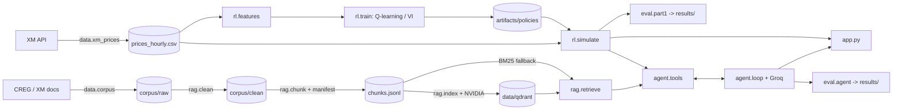

# Architecture

How the system is organized: packages, dependency rules, data contracts, interfaces, fallbacks, and what gets committed. Each section is marked:

- **Implemented**: the code exists and is tested.
- **Planned**: the agreed target design. Refine it when the part is built, and log interface changes in `decisions.md`.

The reasons behind each choice live in [`decisions.md`](decisions.md), and the build order in [`planned_steps.md`](planned_steps.md).

---

## 1. Purpose and scope

A non-regulated commercial or industrial user in Colombia pays the hourly bolsa price and runs a battery (D2). The system:

1. **Learns when to charge, idle or discharge** with Q-learning, falling back to value iteration if needed. Part 1, D3 and O2.
2. **Replays any policy over real prices** with `simulate()` and measures the savings against having no battery.
3. **Answers regulation questions** with a RAG agent over CREG and XM documents, citing article and document. The agent also uses `simulate()` as a tool.
4. **Shows it all** in a Streamlit dashboard with a chat.

Out of scope: solar (D4), demand shifting (D3), battery wear (A3), free-form battery parameters (D9).

## 2. System diagram



**Implemented:** the XM → CSV path and the whole RAG path (web → raw → clean → chunks → Qdrant → retrieve, with the BM25 fallback). `rl.*`, `agent`, `eval` and the app are planned.

## 3. Package map and dependency rules

```
energy/
  config.py          Implemented (O8): root-anchored paths, shared settings, load_env()
  data/              Implemented: acquisition + loading
    io.py            atomic file writes
    xm_prices.py     XM API -> data/raw/xm/*.json -> data/processed/prices_hourly.csv
    corpus.py        manifest (sources.csv) + document download
    prices.py        Implemented: load_prices(), scenario_split()
  rl/                Implemented: Part 1, pure numpy/pandas (value_iteration.py not built)
    battery.py       BatteryPreset, PRESETS, Action, step(..., factory_on)  <- the only battery dynamics
    factory.py       D15/A5 (branch): shift types, ShiftMix/MIXES, add_shifts()
    features.py      relative price level, Discretizer (bin edges fitted on train)
    policies.py      Policy protocol, factory_columns(), NoBattery, NightDay, ShiftSchedule,
                     PriceThreshold (tuned), PerfectForesight
    qlearning.py, value_iteration.py   train -> TabularPolicy (save/load)
    simulate.py      simulate() + SimulationResult
    train.py         python -m energy.rl.train -> artifacts/policies/
  rag/
    clean.py         Implemented: raw -> data/corpus/clean/<id>.md
    chunk.py         Implemented: clean -> data/corpus/chunks.jsonl
    index.py         Implemented: chunks -> Qdrant (data/qdrant/)
    retrieve.py      Implemented: Hit, QdrantRetriever, BM25Retriever, open_retriever()
  agent/             Planned: prompts.py, tools.py, loop.py, llm.py
  eval/              Planned: part1.py, agent.py, questions.csv
  app/charts.py      Planned: pure functions -> plotly figures
app.py               Planned: thin Streamlit entry point
artifacts/policies/  Planned: trained Q-tables (committed)
results/             Planned: metrics CSVs and plots (committed)
```

**Dependency direction:** `config ← data ← {rl, rag} ← agent ← {eval, app}`

- `rl` and `rag` never import each other, `agent`, or `streamlit`.
- Only `app.py` and `energy/app/*` import `streamlit`.
- Heavy or external SDKs (`groq`, `qdrant_client`, `langchain_nvidia_ai_endpoints`, `markitdown`) are imported **inside functions**. If one fails to load or has no key, the RL parts and tests still work. (`clean.py` already imports markitdown lazily.)
- The eval and the app call the same `run_agent()`. There is only one agent code path.
- Entry points are `python -m energy.<pkg>.<module>` with `main(argv) -> int`. There's no `scripts/` folder.

## 4. Data contracts

**Implemented**

| File | Contents |
|---|---|
| `data/raw/xm/PrecBolsNaci_YYYY-MM.json` | Raw XM API payload, one file per month. `Items[].Date` and `HourlyEntities[0].Values.Hour01..Hour24` (strings, COP/kWh). |
| `data/processed/prices_hourly.csv` | `timestamp` (naive Colombian local time, start of hour; `Hour01` = 00:00), `price_cop_kwh` (float). 2024-01-01 to 2025-12-31, 17,544 rows, no gaps (D5). |
| `data/corpus/sources.csv` | `id, title, publisher, url, format (html\|pdf), selector, in_force (yes\|no), superseded_by, notes`. One row per document; the source of citation metadata (D6, D11). |
| `data/corpus/raw/<id>.<format>` | The downloaded document as-is. |
| `data/corpus/clean/<id>.md` | Clean Markdown: main content only, no links, CREG articles marked `## ARTÍCULO n.` (ascending only, D11) and annexes marked `## ANEXO n.` (D13). |
| `data/corpus/chunks.jsonl` | One chunk per line: `doc_id, title, publisher, article ("12", "Anexo 1" or null), in_force, superseded_by, chunk_index, text`. Committed and deterministic. It feeds the BM25 fallback and is the input to the index (D13). |

**Planned**

| File | Contents |
|---|---|
| `artifacts/policies/q_{2,3,4}h_{2025,2024}.npz` + `.json` (2025 implemented) | One Q-table per preset and scenario (D9, D5), plus metadata: seed, episodes, training range, price-level bin edges, battery duration. Committed (KB-sized). |
| `results/*.csv`, `results/*.png` | Part 1 metrics and the agent evaluation. Committed as evidence for the report. |

## 5. Part 1 design (Implemented)

> **Branch `explore/factory-schedule` (D15).** The code below shows the D14 baseline, with these differences:
>
> - **Presets:** 4 h, 8 h and 12 h.
> - **Battery physics:** `step()` and `valid_mask()` take `factory_on`, and a discharge while the factory is off becomes idle.
> - **Frames:** they may carry `shift_type` and `factory_on`. A frame without them means the factory always runs (`factory_columns()`).
> - **Q-table:** shape `(12, levels, 4, 4 shift types, 3)`. `train_q_learning` accepts a list of frames, one per shift pattern, with episodes kept within each.
> - **New baselines:** `ShiftSchedule` and `PriceThreshold`. `PriceThreshold.tune` chooses its cut-offs on the training data, and they're saved as `threshold_<preset>_<year>.json`.
> - **`simulate(..., mix, shift_seed)`:**
>   - It adds shifts over the whole price frame when they're missing.
>   - The summary gains `shift_mix` and `shift_seed`.
>   - The policy ids are `no_battery, night_day, shift_schedule, price_threshold, perfect_foresight, q_learning`.
>   - A missing table falls back to `ShiftSchedule`.
> - **`train.py`:** trains on 5 shift patterns and reports the mean over the 5 `TEST_SHIFT_SEEDS`.

```python
# rl/battery.py
class Action(IntEnum):   # values index the Q-table directly
    IDLE = 0
    CHARGE = 1
    DISCHARGE = 2

@dataclass(frozen=True)
class BatteryPreset:
    id: str              # "2h" | "3h" | "4h"
    label: str
    capacity_kwh: float
    power_kw: float
    round_trip_efficiency: float = 0.9
    # properties: duration_h (int), n_levels, one_way_efficiency; every battery starts empty

PRESETS: dict[str, BatteryPreset]

def step(level: int, action: Action, preset: BatteryPreset) -> tuple[int, float]:
    """Return (next_level, grid_kwh): +P/η when charging, −P·η when discharging.
    An impossible action is treated as idle."""

def transition_tables(preset) -> tuple[np.ndarray, np.ndarray]: ...  # built from step()
def valid_mask(preset) -> np.ndarray: ...
```

- **`step()` is the only implementation of the battery physics.** Q-learning, value iteration, the baselines and `simulate` all call it, so training and evaluation can't silently diverge. It must be tested (efficiency, SoC bounds).
- **State (D14):** an hour pair (12 values), the SoC level (0 to the battery's duration in hours; one full-power hour moves it one level), and a **relative** price level. The price level is the price ÷ the trailing 168-hour mean, in 4 bins. The `Discretizer` fits the quartile bin edges on training data only and is saved with the policy.
- **Reward (D14, option A):** relative price × (kWh delivered − kWh bought), with √0.9 efficiency each way. No wear (A3), and every discharged kWh replaces a purchase (A2). `simulate` always reports COP.
- **Episodes:** one week, starting empty, γ ≈ 0.99. Impossible actions are masked.
- **Presets (D9):** 2 h, 3 h and 4 h at 100 kW, one Q-table per preset and scenario. Scenarios are 2025 and 2024, each training on January–September and testing on October–December (D5).

```python
# rl/policies.py
class Policy(Protocol):
    name: str
    def actions(self, frame: pd.DataFrame, preset: BatteryPreset) -> np.ndarray:
        """One int8 action per row of frame (timestamp, price_cop_kwh, rel_price)."""
```

`actions()` returns the whole sequence at once, replacing the planned per-hour `act(Observation)`. That makes replay fast, and lets perfect foresight see the whole period. Causal policies only look at row t to decide hour t.

**Speed and size measures:**
- Features are computed once, before the split.
- The training loop runs over plain lists and the lookup tables from `transition_tables`, with the masks precomputed.
- Training stops early after 20 passes with no change.
- Q-tables are `float32` and stored compressed (`.npz` + `.json`, no pickle).
- Jobs run in parallel processes, with order-independent seeds (`energy.rl.train`).

Policies:
- **`TabularPolicy`**, from Q-learning or value iteration.
- **Baselines:**
  - `NoBattery`
  - `NightDay`, a fixed schedule: charge from 02:00 and discharge from 18:00, for as many hours as the battery's duration
  - `PerfectForesight`, a DP optimum over the actual prices. It isn't causal, but it gives the upper bound for the metric "% of optimum captured" (O3).

## 6. `simulate()` contract (Implemented)

```python
@dataclass(frozen=True)
class SimulationSummary:
    policy: str
    preset_id: str
    start: date
    end: date
    hours: int
    savings_cop: float
    bought_kwh: float
    delivered_kwh: float
    cycles: float          # delivered / (capacity × η)
    invalid_actions: int   # turned into idle

@dataclass(frozen=True)
class SimulationResult:
    summary: SimulationSummary
    hourly: pd.DataFrame  # timestamp, price, action, soc, grid_kwh, savings_cop, cum_savings_cop

def simulate(policy: str | Policy, start: date, end: date,
             preset: str | BatteryPreset,
             prices: pd.DataFrame | None = None,
             policies_dir: Path = DEFAULT_POLICIES_DIR) -> SimulationResult: ...
```

- **Savings** are measured against the same hours with no battery.
- `savings_pct_of_energy_cost` was dropped: under A2 we don't know the plant's total load.
- The string id `q_learning` loads `q_<preset>_<start.year>`. If that file is missing, it logs a warning and uses `NightDay`.
- `policy` and `preset` accept string ids, so Streamlit caching and the agent's tools can pass plain values.
- Raises `ValueError` if the dates are outside the data or `start > end`. The tool layer turns that into an observation for the model.
- **One function serves three users:** the Part 1 metric, the dashboard charts, and the agent tool. All three therefore report the same numbers.

## 7. RAG pipeline

1. **Download** (Implemented): `python -m energy.data.corpus`, driven by the manifest.
2. **Clean** (Implemented): `python -m energy.rag.clean`. Main-content selector → markitdown → strip links → normalize → mark CREG articles (D11) and annexes (D13).
3. **Chunk** (Implemented, D13): `python -m energy.rag.chunk`, two strategies.
   - **CREG** documents are split on `## ARTÍCULO n` and `## ANEXO n.` headings, keeping the heading line *in the chunk text*. The headings carry the article's first paragraph, so dropping them, as `MarkdownHeaderTextSplitter` does by default, would lose content. A long section is split further with the recursive splitter, and each piece keeps its label (`"12"`, `"Anexo 1"`).
   - The embedded and BM25 text is `embedding_text(chunk)`: title + article/annex header + text.
   - **Everything else** uses `RecursiveCharacterTextSplitter` (~900 / 120, drop chunks under 30 characters).
   - Metadata comes from the manifest. Output: `chunks.jsonl`.
4. **Index** (Implemented, D13): `rag/index.py`. NVIDIA `nemotron-3-embed-1b` → Qdrant at `data/qdrant/` (cosine, embedding dimension probed at runtime). Run once; the app only opens it. The index is **not committed** (D8).
5. **Retrieve** (Implemented, D13): `rag/retrieve.py`.

```python
@dataclass(frozen=True)
class Hit:
    doc_id: str
    title: str
    publisher: str
    article: str | None
    in_force: bool
    superseded_by: str
    chunk_index: int
    text: str
    score: float

    @property
    def citation(self) -> str:  # "Resolución CREG 101 113 de 2026, Art. 12"
        ...

class Retriever(Protocol):
    name: str  # "qdrant-nvidia" | "bm25"
    def search(self, query: str, k: int = 5) -> list[Hit]: ...
```

**In-force handling:** a hit from a replaced document (`in_force=False`) carries `superseded_by`. The prompt tells the agent to say so, and to cite the current rule for anything about today's rules.

## 8. Agent (Planned)

```python
@dataclass(frozen=True)
class Tool:
    name: str
    description: str
    parameters: dict   # JSON Schema
    fn: Callable[..., dict]

def build_registry(retriever: Retriever) -> dict[str, Tool]: ...
def run_tool(registry, name: str, raw_args: str) -> str:
    """JSON string; never raises: returns {"error": ...} instead."""

@dataclass
class AgentResult:
    answer: str
    tool_calls: list[ToolCallRecord]
    citations: list[str]
    stopped: Literal["answer", "t_max", "llm_error"]

def run_agent(question: str, history: list[dict], registry, chat: ChatFn,
              t_max: int = T_MAX) -> AgentResult: ...
```

**Tools:**
- `search_regulation(query, k)` returns hits with their citation, `in_force` and `superseded_by`.
- `simulate_battery(policy, preset_id, start_date, end_date)` returns the **summary plus at most about 12 aggregated rows**, never the hourly trace. The date range is capped at 366 days.
- Optional: `price_stats(start, end)`.

**Loop:**
- A manual Groq tool-calling loop, capped at `T_max`.
- Tool errors go back to the model as observations.
- A list of fallback models, with one retry on malformed tool calls.

**Testability:** `ChatFn` is injected, so tests use a scripted fake LLM to cover the `T_max` cap, error observations and citation extraction offline.

**Citations:** `AgentResult.citations` keeps only the citations in the answer that match hits retrieved in this run. That gives the evaluation a deterministic check.

## 9. Dashboard (Planned)

`app.py` stays thin; the charts are pure functions in `energy/app/charts.py`.

- **Caching:**
  - `@st.cache_data` for the prices and for `simulate(policy_id, preset_id, start, end)` (hashable arguments only).
  - `@st.cache_resource` for the policies, the retriever (exactly one `QdrantClient`, since local mode takes a file lock) and the Groq client.
- **Sidebar:**
  - preset, date range, and the policies to compare
  - a **status panel**: whether the Groq key is present, and which retriever is in use (`qdrant-nvidia` or `bm25`)
- **Tabs:**
  1. Price vs. actions over SoC.
  2. Cumulative savings: the policy against the baselines.
  3. Chat, with an expander per answer showing the tool calls and citations.
- **Error handling:** every external call is wrapped and shown with `st.error`. No exception from `agent/` or `rag/` reaches the top level.

## 10. Configuration and secrets

- **Implemented (O8): `energy/config.py`.**
  - It builds every path from `ROOT`, the repo root, and holds the shared settings.
  - `load_env()` reads `ROOT/.env` without overriding real environment variables. It's called only in entry points, never on import, so tests don't pick up real keys.
  - Every CLI still accepts flags to override the paths.
- **Package not installed:** `pyproject.toml` has no build system, so `python -m energy.<module>` needs the repo root as the working directory, or `PYTHONPATH` set to it. The paths themselves no longer depend on where you start.
- **Keys:** `.env` (gitignored) holds them; `.env.example` lists them with no values.

| Key | Used by | Without it |
|---|---|---|
| `NVIDIA_API_KEY` | building the index, and embedding questions | Retrieval falls back to BM25 |
| `GROQ_API_KEY` | the agent's LLM | Chat shows the error and the passages retrieved; the RL tabs still work |

## 11. Fallback matrix

| Dependency | Primary | Fallback | Status |
|---|---|---|---|
| XM API | Not used at runtime | Committed CSV snapshot | Implemented |
| CREG / XM websites | Not used at runtime | Committed raw and clean documents | Implemented |
| NVIDIA embeddings | Query-time embedding | `BM25Retriever` over the committed `chunks.jsonl` (no torch, no second index), chosen by `open_retriever()` | Implemented |
| Qdrant | Opened once (the app will cache `open_retriever()`) | BM25 if opening fails (lock, missing index, version) | Implemented |
| Groq | Ordered model list, one retry | Retrieval-only answer: the error plus the top passages with citations | Planned |
| Q-table missing | Load from `artifacts/policies/` | `NightDay` baseline (on the D15 branch: `ShiftSchedule`, also when the threshold file is missing), with a logged warning (the app should also show it) | Implemented |

## 12. Artifacts and reproducibility

| Artifact | Committed? | Rebuild |
|---|---|---|
| `data/raw/xm/`, `data/processed/prices_hourly.csv` | Yes | `uv run python -m energy.data.xm_prices` |
| `data/corpus/raw/`, `data/corpus/sources.csv` | Yes | `uv run python -m energy.data.corpus` |
| `data/corpus/clean/` | Yes | `uv run python -m energy.rag.clean` |
| `data/corpus/chunks.jsonl` | Yes (planned) | `rag.chunk` |
| `data/qdrant/` | **No** (D8) | `rag.index`; needs `NVIDIA_API_KEY` |
| `artifacts/policies/` | Yes | `uv run python -m energy.rl.train --scenarios 2025` (seeded, about 4 s) |
| `results/` | Yes (planned) | `eval.part1`, `eval.agent` |

Training uses a fixed seed that is recorded in the policy's `.json`. Before submission, test with a clean clone (`git clone` → `uv sync` → run) and **no** `.env`.

## 13. Testing

- `uv run pytest` runs offline. HTTP is mocked with `httpx.MockTransport`. Tests that call real services are marked `network` and are skipped by default (`uv run pytest -m network` to run them).
- **Implemented:**
  - Data and RAG: `tests/test_io.py`, `test_xm_prices.py`, `test_corpus.py`, `test_clean.py`, `test_chunk.py`, `test_index.py`, `test_retrieve.py` (fake embedder + in-memory Qdrant).
  - Part 1: `test_prices.py`, `test_features.py`, `test_battery.py`, `test_policies.py`, `test_qlearning.py`, `test_simulate.py`, `test_train.py`. They use the `synthetic_prices` fixture, and check the `step()` invariants, hand-computed savings, determinism, and that 1 and 2 workers give the same results.
- **Planned:**
  - a check that an article's text is present in its chunk
  - agent loop tests with a scripted fake LLM (`T_max`, tool errors, citations)

## 14. Documentation conventions

- **Google-style docstrings.** Every module has a docstring: purpose, how to run it, inputs and outputs. Public functions and classes have a summary line, plus `Args` / `Returns` / `Raises` when they aren't obvious. Type hints carry the types, so `Args` describes meaning and units only.
- Use dataclasses, not dicts, for data that crosses a layer boundary. The JSON tool outputs are the one exception.
- Comments explain *why* and point to decision IDs (`# one month per request, see D10`). They don't repeat what the code says.
- The README covers setup, the run order, what works without API keys, results, limitations and the AI-use declaration. Rationale goes in `decisions.md`, structure in this file. There are no per-package READMEs.

Example:

```python
def simulate(policy: str | Policy, start: date, end: date,
             preset: str | BatteryPreset, prices: pd.DataFrame | None = None) -> SimulationResult:
    """Replay a dispatch policy hour by hour over real bolsa prices.

    Savings are measured against having no battery: under A2, every discharged
    kWh replaces a kWh bought at that hour's price.

    Args:
        policy: Policy object or registry id (``"q_learning"``, ``"night_day"``...).
        start: First day, inclusive. Must lie inside the price snapshot.
        end: Last day, inclusive.
        preset: Battery preset or its id from ``PRESETS``.
        prices: Optional price frame; defaults to ``load_prices()``.

    Returns:
        Summary metrics plus the hourly trace (timestamp, price, action, soc, savings).

    Raises:
        ValueError: If the dates are outside the data or ``start > end``.
    """
```
